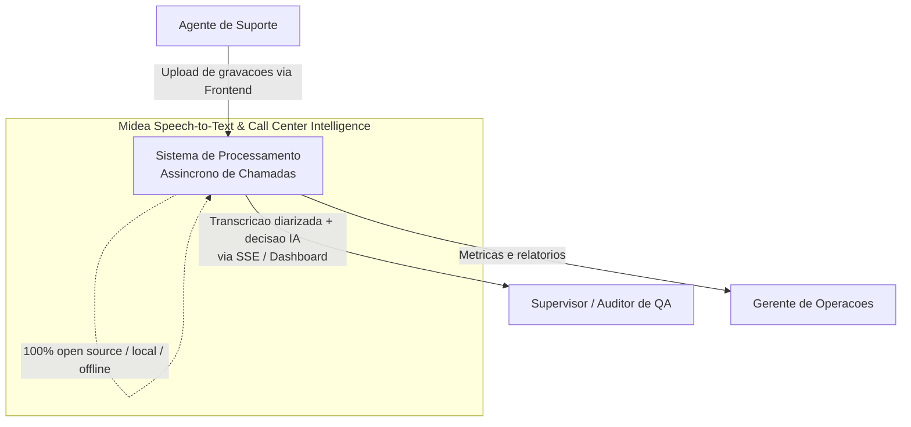
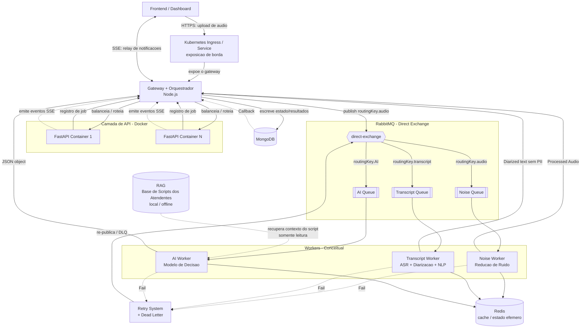
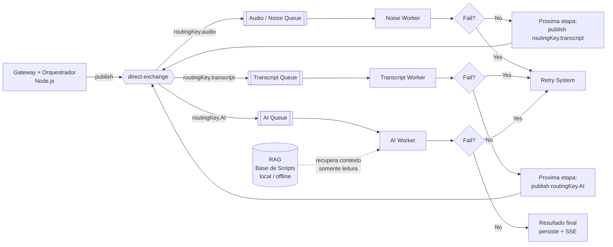
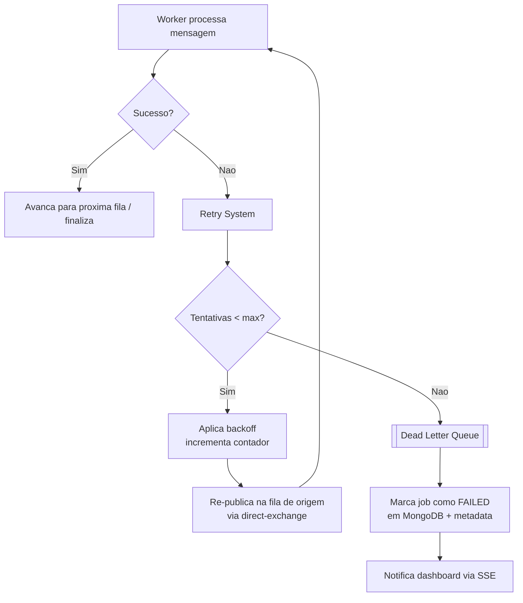
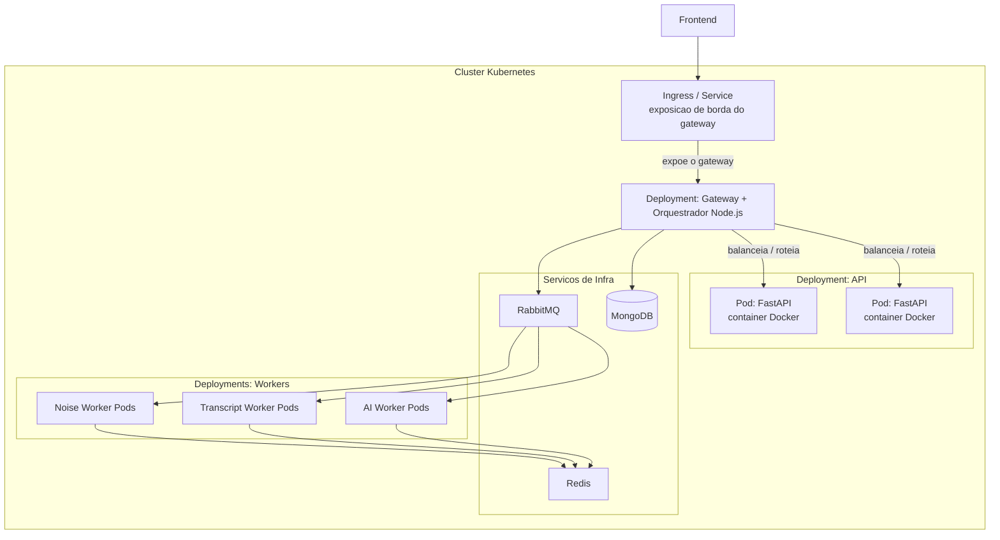

# Documento de Design: System Design (Midea Speech-to-Text & Call Center Intelligence — PoC)

## Overview
*Visão Geral*

Este documento descreve o design técnico de alto nível do sistema **Midea Speech-to-Text & Call Center Intelligence**, uma prova de conceito (PoC) para processamento, transcrição (speech-to-text), diarização e auditoria inteligente de gravações do call center de suporte técnico da Midea. O sistema é **assíncrono, orientado a eventos e baseado em microsserviços**, com mensageria via RabbitMQ/Redis, um **Retry System nativo** e tolerância a falhas.

A arquitetura-alvo completa se organiza em três fluxos de processamento (Workers): **Redução de Ruído**, **Transcrição** e **Decisão por IA**. A lane de IA é apoiada por um **RAG (Retrieval-Augmented Generation) local/offline sobre os scripts/protocolos de atendimento de referência**, que fornece ao AI Worker o contexto do roteiro que os atendentes deveriam seguir, fundamentando a **validação de aderência ao script**. Todo o stack é **100% open source** e projetado para operar **localmente/offline**.

Este documento cobre a **primeira fatia (first slice)** do design, intencionalmente mais simples que o pipeline completo. O foco é o **sistema de backend inicial**: ponto de entrada → Kubernetes Ingress (exposição de borda) → Gateway/Orquestrador Node.js (entrada HTTP, recebimento do upload, balanceamento/roteamento para os contêineres FastAPI e orquestração das lanes) → contêineres FastAPI (Docker) → mensageria RabbitMQ (direct-exchange com routing keys) → persistência em MongoDB → notificações ao dashboard via SSE/callback. A ingestão de áudio ocorre sempre via API/gateway (nunca com acesso direto aos workers). Os três workflows e o Retry System são tratados em **nível conceitual**, acomodando a arquitetura-alvo sem detalhar os internals de ML de cada worker.

> Observação: Este design utiliza como base conceitual os dois diagramas de arquitetura anexados em `Docs/Images/image.png` (arquitetura geral) e `Docs/Images/image copy.png` (detalhe de mensageria RabbitMQ) e visão geral do projeto em Docs/markdown/project-brief.md.

### Objetivos do Sistema

- Ingerir gravações de chamadas via upload pelo frontend, roteado **através da API** (endpoint de upload na API, sem acesso direto aos workers).
- Processar áudio de forma assíncrona e tolerante a falhas por três fluxos especializados.
- Produzir transcrições diarizadas (separação agente vs. consumidor) **sem dados pessoais** (conformidade LGPD).
- Gerar objetos JSON estruturados com validação de regras de negócio via LLMs locais.
- Notificar supervisores/auditores de QA em tempo real no dashboard.
- Operar de forma local/offline, com escalabilidade horizontal via Docker + Kubernetes.

### Usuários-alvo

- **Supervisores/Auditores de QA**: consumidores do dashboard de auditoria.
- **Agentes de suporte**: fonte das chamadas processadas.
- **Gerentes de operação**: visão consolidada e métricas.

---

## Architecture
*Arquitetura*

### 1. Diagrama de Contexto do Sistema

Visão de mais alto nível: atores externos e o sistema como uma caixa única.

### 2. Diagrama de Contêineres / Componentes (Primeira Fatia)

Detalha os componentes internos do backend inicial e suas interações. As três lanes (Ruído, Transcrição, IA) aparecem em nível conceitual.

### 3. Fluxo de Mensagens Assíncronas (Direct-Exchange + Routing Keys)

Baseado no detalhe de mensageria da Imagem 2: um Worker publica no `direct-exchange`, que roteia por routing key para a fila correta; cada Worker processa e decide avançar ou reprocessar (Fail → Retry).

### 4. Fluxo de Retry e Dead-Letter

Detalha o loop `Fail → Retry System` e o encaminhamento para dead-letter quando as tentativas se esgotam.

---

## Components and Interfaces
*Componentes e Responsabilidades*

### Componente 1: Gateway + Orquestrador (Node.js)

**Propósito**: Ponto de entrada HTTP único da aplicação e coordenador do fluxo assíncrono. É o **único** componente exposto na borda (via Kubernetes Ingress/Service, que faz exposição de borda + terminação TLS). Atua como **reverse proxy / balanceador em nível de aplicação** à frente das réplicas FastAPI, como **único produtor de mensagens para o `direct-exchange`** e, simultaneamente, como **sequenciador das três lanes**. O Ingress/Service do Kubernetes apenas expõe este gateway na borda; o balanceamento lógico entre os contêineres FastAPI é feito pelo próprio gateway Node.js.

**Responsabilidades**:
- Receber o **upload de áudio** do frontend (ingestão sempre via API/gateway, nunca acesso direto aos workers).
- Realizar o **balanceamento/roteamento** das requisições em nível de aplicação (reverse proxy) para os contêineres FastAPI disponíveis, considerando um contêiner disponível apenas quando responde à verificação de prontidão dentro do limite definido.
- Ser o **único produtor** de mensagens para o `direct-exchange`, publicando exclusivamente com uma das routing keys válidas (`routingKey.audio`, `routingKey.transcript`, `routingKey.AI`) conforme a lane de destino.
- Sequenciar as etapas (Ruído → Transcrição → IA) conforme os resultados retornam, usando `workflow_states` como fonte de verdade.
- Escrever/atualizar o estado do job e os resultados em MongoDB.
- Encaminhar falhas ao **Retry System** e propagar o estado final (sucesso/falha).
- **Relaiar** as notificações **SSE** ao dashboard, inclusive os eventos emitidos pelos contêineres FastAPI.

### Componente 2: Contêineres de API (FastAPI + Docker)

**Propósito**: Camada de aplicação stateless; cada contêiner Docker encapsula **1 servidor FastAPI**. Recebe as requisições **roteadas pelo Gateway/Orquestrador Node.js** (não diretamente de um load balancer do Kubernetes).

**Responsabilidades**:
- Expor o **endpoint de upload** de áudio, recebendo as requisições roteadas pelo gateway (ingestão via API, nunca acesso direto aos workers).
- Validar payload (formato de áudio, tamanho de arquivo, metadados) com Pydantic **antes** de aceitar o Job; em caso de payload inválido, **rejeitar a requisição sem criar documento em `call_jobs`**, preservando o estado do sistema e retornando erro de validação indicando o campo/regra violada.
- Criar o registro de job (`call_jobs` com `status = RECEIVED` e `audioRef` presente) e **retornar ao cliente o `call_jobs._id` criado** na confirmação do upload; delegar o início/sequenciamento do pipeline ao gateway/orquestrador.
- Emitir eventos **SSE** de progresso, relaiados ao dashboard **através do gateway Node.js**.
- Receber **callbacks** do MongoDB/gateway sobre mudança de estado dos jobs.

> **Nota sobre o Kubernetes Ingress**: o Ingress/Service do Kubernetes apenas **expõe o Gateway Node.js na borda** (ponto de entrada externo) e realiza a terminação TLS de borda. O balanceamento de aplicação entre as réplicas FastAPI é responsabilidade do Gateway/Orquestrador Node.js.

### Componente 3: RabbitMQ (Exchange + Filas)

**Propósito**: Backbone de mensageria assíncrona com roteamento determinístico.

**Responsabilidades**:
- `direct-exchange` roteia mensagens por routing key para a fila correta.
- **Noise Queue**, **Transcript Queue**, **AI Queue** desacoplam produtores (Gateway/Orquestrador Node.js) de consumidores (workers).
- Suportar **Dead Letter Exchange/Queue** para mensagens cujas tentativas se esgotaram.

### Componente 4: Redis

**Propósito**: Armazenamento de estado efêmero / cache de apoio ao processamento.

**Responsabilidades**:
- Cache de estado de processamento de curta duração por lane.
- Apoio a controle de tentativas e locks leves (conceitual nesta fatia).

### Componente 5: Noise Worker (conceitual)

**Propósito**: Pré-processamento acústico para elevar a relação sinal-ruído.

**Responsabilidades (alto nível)**:
- Consumir da Noise Queue.
- Aplicar Deep Complex Filtering (DeepFilterNet3) + neural vocoding / speech restoration.
- Transformar **Raw Audio → Processed Audio**.
- Persistir estado na Noise State storage; sinalizar `Fail` ao Retry System em erro.

### Componente 6: Transcript Worker (conceitual)

**Propósito**: Converter áudio em texto diarizado e sem dados pessoais.

**Responsabilidades (alto nível)**:
- Consumir da Transcript Queue (preferindo `.WAV` não comprimido).
- Executar ASR (Whisper Large-v3 Turbo / WhisperX) + diarização (Silero VAD + Pyannote.audio).
- Realizar **Merge** dos turnos e etapa de **NLP para mascaramento/remoção de PII** (LGPD).
- Produzir **Diarized Speech text sem dados pessoais**; sinalizar `Fail` em erro.

### Componente 7: AI Worker (conceitual)

**Propósito**: Interpretação contextual e geração de objeto JSON estruturado.

**Responsabilidades (alto nível)**:
- Consumir da AI Queue.
- **Consultar o RAG (Base de Scripts dos Atendentes)** para obter o contexto do script de referência (trechos/protocolos relevantes) **antes** de gerar a decisão, fundamentando a validação de aderência ao roteiro.
- Interpretar o texto diarizado via LLMs locais (ex.: Qwen 4B), combinando-o com o contexto de script recuperado do RAG.
- Validar regras de negócio (incluindo aderência ao script de atendimento) e gerar **JSON object**, registrando as referências de script que fundamentaram cada veredicto.
- Disparar notificações em tempo real para a UI via SSE; sinalizar `Fail` em erro.

### Componente 8: Retry System

**Propósito**: Receber as arestas `Fail` de todas as três lanes e orquestrar reprocessamento.

**Responsabilidades**:
- Receber falhas das lanes, aplicar política de retry (contador + backoff).
- Re-publicar mensagens na fila de origem via `direct-exchange`.
- Encaminhar para **Dead Letter Queue** quando o máximo de tentativas é atingido.
- Registrar metadados de retry/falha em MongoDB.

### Componente 9: MongoDB

**Propósito**: Persistência durável de jobs, estados por lane, resultados e metadados.

**Responsabilidades**:
- Armazenar documentos de job/call record, estado por lane, resultado de transcrição/diarização, objeto de decisão de IA e metadados de retry/dead-letter.
- Emitir **Callback** para o Gateway/Orquestrador Node.js ao concluir/atualizar estados relevantes.

### Componente 10: Canal SSE

**Propósito**: Entregar notificações em tempo real do backend ao dashboard.

**Responsabilidades**:
- Manter conexões SSE por job/sessão de auditoria.
- Emitir eventos de progresso e resultado (ex.: `NOISE_DONE`, `TRANSCRIPT_DONE`, `AI_DONE`, `FAILED`).

### Componente 11: RAG — Base de Scripts dos Atendentes (conceitual)

**Propósito**: Indexar/armazenar os **scripts e protocolos de atendimento de referência** (o roteiro que os atendentes deveriam seguir) e fornecer **recuperação de contexto** — trechos relevantes do script — ao AI Worker, para fundamentar a **validação de aderência ao roteiro**. Esta é uma peça **conceitual** nesta fatia: os internals de embeddings/vector-store não são especificados aqui.

**Responsabilidades (alto nível)**:
- Manter uma base de conhecimento dos scripts/protocolos de atendimento de referência (versões/trechos), indexada para recuperação.
- Fornecer ao AI Worker, sob demanda, os trechos de script mais relevantes ao contexto da chamada para fundamentar a avaliação de regras de aderência.
- Operar como **fonte de recuperação (somente leitura) exclusiva da lane de IA** — **não** é produtor de mensagens para o `direct-exchange` nem participa das lanes de Ruído/Transcrição.
- Ser **open source** e executar **local/offline**, sem dependências de serviços externos de nuvem (consistente com a restrição 100% open source local/offline).

> **Nota (nível conceitual)**: os mecanismos internos de embeddings, chunking e vector-store ficam fora do escopo desta primeira fatia; o RAG é tratado em alto nível, como as demais lanes/workers (Ruído/Transcrição/IA). O detalhamento do stack concreto será definido em fase posterior.

---

## Data Models
*Modelos de Dados — Esquemas de Alto Nível, MongoDB*

Os esquemas abaixo são descritos em nível conceitual (coleções/documentos), sem detalhes de implementação.

### Coleção 1: `call_jobs` (Job / Call Record)

Documento mestre de uma gravação em processamento.

| Campo | Tipo (conceitual) | Descrição |
|-------|-------------------|-----------|
| `_id` | ObjectId | Identificador único do job |
| `audioRef` | string | Referência ao áudio ingerido (raw) |
| `originalFilename` | string | Nome original do arquivo enviado |
| `audioFormat` | string | Formato do áudio (preferir `.WAV`) |
| `status` | enum | `RECEIVED` \| `NOISE` \| `TRANSCRIPT` \| `AI` \| `DONE` \| `FAILED` |
| `uploadedBy` | string | Identificador do agente/sessão de origem |
| `createdAt` / `updatedAt` | datetime | Carimbos de tempo |

**Regras de validação (alto nível)**: `status` deve ser um dos valores enumerados; `audioRef` obrigatório após ingestão bem-sucedida.

### Coleção 2: `workflow_states` (Estado por Lane)

Estado de processamento de cada lane para um job.

| Campo | Tipo (conceitual) | Descrição |
|-------|-------------------|-----------|
| `jobId` | ObjectId | Referência ao `call_jobs` |
| `lane` | enum | `NOISE` \| `TRANSCRIPT` \| `AI` |
| `state` | enum | `QUEUED` \| `PROCESSING` \| `SUCCESS` \| `FAILED` |
| `inputRef` | string | Referência ao insumo da lane |
| `outputRef` | string | Referência ao resultado da lane |
| `attempts` | int | Nº de tentativas acumuladas |
| `startedAt` / `finishedAt` | datetime | Carimbos de tempo |

**Regras de validação (alto nível)**: unicidade por `(jobId, lane)`; `outputRef` presente quando `state = SUCCESS`.

### Coleção 3: `transcripts` (Resultado de Transcrição/Diarização)

Resultado diarizado e sem dados pessoais.

| Campo | Tipo (conceitual) | Descrição |
|-------|-------------------|-----------|
| `jobId` | ObjectId | Referência ao `call_jobs` |
| `segments` | array | Lista de turnos diarizados |
| `segments[].speaker` | enum | `AGENT` \| `CONSUMER` |
| `segments[].start` / `end` | number | Marcação temporal do turno |
| `segments[].text` | string | Texto **mascarado para PII** (LGPD) |
| `piiMasked` | boolean | Indica que a etapa de NLP/PII foi aplicada |
| `language` | string | Idioma detectado |

**Regras de validação (alto nível)**: nenhum segmento pode ser persistido com `piiMasked = false`; `speaker` restrito ao enumerado.

### Coleção 4: `ai_decisions` (Objeto de Decisão de IA)

Objeto JSON estruturado gerado pelo AI Worker.

| Campo | Tipo (conceitual) | Descrição |
|-------|-------------------|-----------|
| `jobId` | ObjectId | Referência ao `call_jobs` |
| `decision` | object | JSON estruturado com validação de regras de negócio |
| `rulesEvaluated` | array | Regras avaliadas e seus veredictos (inclui aderência ao script) |
| `scriptContextRefs` | array | Referências/trechos de script recuperados do RAG que fundamentaram a decisão/avaliação de regras (ex.: `scriptId`, `version`, trecho/chunk) |
| `summary` | string | Resumo auditável (sem PII) |
| `model` | string | Modelo/versão usado (ex.: Qwen 4B / Mistral 24B) |
| `createdAt` | datetime | Carimbo de tempo |

**Regras de validação (alto nível)**: `decision` deve ser um objeto JSON válido conforme o schema de negócio; derivado de `transcripts` com `piiMasked = true`. Todo veredicto de **aderência ao script** em `rulesEvaluated` deve ser rastreável a pelo menos uma entrada de `scriptContextRefs` (contexto recuperado do RAG que o fundamentou).

### Coleção 5: `attendant_scripts` (Base de Scripts dos Atendentes — conceitual)

Base de conhecimento dos scripts/protocolos de atendimento de referência que alimenta o RAG. Descrita em **nível conceitual** nesta fatia — os internals de embeddings/vector-store não são especificados.

| Campo | Tipo (conceitual) | Descrição |
|-------|-------------------|-----------|
| `scriptId` | string | Identificador do script/protocolo de atendimento |
| `version` | string | Versão do roteiro de referência |
| `content` | string | Conteúdo do script de referência (texto integral) |
| `chunks` | array | Trechos indexáveis do script para recuperação (conceitual) |
| `active` | boolean | Indica se a versão está vigente para consulta |
| `createdAt` / `updatedAt` | datetime | Carimbos de tempo |

**Regras de validação (alto nível)**: é **fonte de recuperação (somente leitura) para a lane de IA** — não é alimentada pelos workers do pipeline; os `scriptContextRefs` persistidos em `ai_decisions` referenciam entradas desta coleção (`scriptId`/`version`/trecho).

### Coleção 6: `retry_metadata` (Retry / Dead-Letter)

Metadados de tentativas e falhas terminais.

| Campo | Tipo (conceitual) | Descrição |
|-------|-------------------|-----------|
| `jobId` | ObjectId | Referência ao `call_jobs` |
| `lane` | enum | Lane de origem da falha |
| `attempts` | int | Tentativas realizadas |
| `maxAttempts` | int | Limite configurado |
| `lastError` | string | Causa da última falha |
| `deadLettered` | boolean | Enviado para DLQ |
| `history` | array | Histórico de tentativas (timestamp, erro) |

**Regras de validação (alto nível)**: `deadLettered = true` somente quando `attempts >= maxAttempts`.

---

## Visão de Deployment

**Notas de deployment (alto nível)**:
- Cada contêiner Docker encapsula **1 servidor FastAPI**; o Deployment de API escala horizontalmente por réplicas.
- O **Ingress/Service do Kubernetes** apenas **expõe o Gateway Node.js na borda** (ponto de entrada externo + terminação TLS de borda); o **balanceamento de aplicação** entre as réplicas FastAPI e a **orquestração** das lanes são realizados pelo próprio **Gateway/Orquestrador Node.js**.
- Gateway/Orquestrador Node.js, RabbitMQ, Redis, MongoDB e os três Workers são Deployments/Services independentes dentro do cluster.
- Todo o stack roda **local/offline** (imagens open source autocontidas).

---

## Error Handling
*Tratamento de Erros e Estratégia de Retry*

- **Aresta `Fail` por lane**: qualquer worker (Ruído, Transcrição, IA) que falhe encaminha a mensagem ao **Retry System**, em vez de descartá-la.
- **Política de retry**: o Retry System incrementa o contador de tentativas, aplica backoff e **re-publica** a mensagem na fila de origem via `direct-exchange`.
- **Dead-letter**: ao atingir `maxAttempts`, a mensagem vai para a **Dead Letter Queue**, o job é marcado como `FAILED` em MongoDB e o metadata é registrado em `retry_metadata`.
- **Routing key inválida**: uma mensagem publicada com routing key fora do conjunto válido `{routingKey.audio, routingKey.transcript, routingKey.AI}` **não** é entregue a nenhuma das filas (Noise/Transcript/AI); em vez de descarte silencioso, ela é encaminhada à **Dead Letter Queue**, preservando a mensagem.
- **Notificação de falha**: falhas terminais e progresso são comunicados ao dashboard via **SSE**.
- **Idempotência**: o reprocessamento não deve duplicar resultados — o estado por lane (`workflow_states`) é a fonte de verdade para evitar efeitos colaterais repetidos.
- **Callback**: o MongoDB emite callback ao Gateway/Orquestrador Node.js para refletir mudanças de estado, que são relaiadas ao dashboard.

---

## Testing Strategy
*Estratégia de Testes*

Esta seção descreve, em alto nível, como as **propriedades de correção** e os principais comportamentos do sistema serão validados na PoC. O detalhamento de casos de teste e implementação fica para a fase de tarefas; aqui o foco é a abordagem.

### Testes Baseados em Propriedades (PBT)

As invariantes listadas em **Correctness Properties** são o insumo direto para testes baseados em propriedades. A estratégia é gerar entradas variadas (jobs, mensagens, sequências de falha/sucesso) e verificar que cada invariante se mantém, por exemplo:

- **Roteamento determinístico**: para qualquer routing key válida (`routingKey.audio` / `routingKey.transcript` / `routingKey.AI`), a mensagem sempre chega à fila correspondente e a nenhuma outra.
- **Sequenciamento das lanes**: um job nunca entra na lane de Transcrição sem sucesso prévio na de Ruído, nem na de IA sem sucesso na de Transcrição.
- **Limite de tentativas**: uma mensagem só é enviada para a Dead Letter Queue quando `attempts >= maxAttempts`.
- **Consistência de estado**: existe no máximo um documento em `workflow_states` por `(jobId, lane)`.
- **Idempotência de retry**: reprocessar a mesma mensagem não gera resultados duplicados para o mesmo `(jobId, lane)`.

### Testes de Integração do Fluxo de Mensageria

Validação ponta a ponta do backbone RabbitMQ: publicação no `direct-exchange`, roteamento por routing key às filas corretas (Noise/Transcript/AI) e consumo pelos workers conceituais. Os testes verificam o encadeamento Ruído → Transcrição → IA e a ausência de perda de mensagem (toda mensagem termina concluída ou em dead-letter).

### Testes do Loop de Retry e Dead-Letter

Cenários que forçam a aresta `Fail` em cada lane para exercitar o Retry System: incremento do contador de tentativas, aplicação de backoff, re-publicação na fila de origem e, ao esgotar `maxAttempts`, encaminhamento à Dead Letter Queue com marcação `FAILED` em `call_jobs` e registro em `retry_metadata`. Inclui a verificação da notificação SSE de estado terminal.

### Validação da Fronteira de PII/LGPD

Testes que garantem a invariante de conformidade: nenhum documento em `transcripts` é persistido com `piiMasked = false` e nenhum `ai_decisions` é derivado de texto não mascarado. A fronteira da etapa de NLP é testada de forma que dados pessoais nunca atravessem para o AI Worker ou para a persistência.

### Validação Funcional e de Contrato da API

Testes do endpoint de upload (ingestão sempre via API/gateway) cobrindo validação de payload (formato de áudio, metadados) e a criação do `call_jobs._id`, assegurando que nenhum worker receba trabalho sem passar pelo Gateway/Orquestrador Node.js e pelos contêineres FastAPI. Inclui verificação dos eventos SSE de progresso (`NOISE_DONE`, `TRANSCRIPT_DONE`, `AI_DONE`, `FAILED`).

---

## Considerações Não Funcionais (Relevantes à PoC)

- **Desempenho (RTF < 1.0)**: o Real-Time Factor de cada etapa de processamento deve ficar abaixo de 1.0 (processar mais rápido que o tempo de áudio) para viabilidade da PoC.
- **Fronteira de PII/LGPD**: nenhum dado pessoal pode atravessar a fronteira da etapa de NLP; o AI Worker e a persistência de transcrição operam **somente sobre texto já mascarado** (`piiMasked = true`).
- **Operação offline/local**: todo o stack é 100% open source e executa localmente, sem dependências de serviços externos de nuvem — **inclusive o RAG** sobre os scripts de atendimento, que indexa e recupera o contexto do roteiro local/offline.
- **Fundamentação da validação de aderência ao script**: a lane de IA usa um **RAG local/offline sobre os scripts dos atendentes** para fundamentar a verificação sistemática de aderência ao roteiro; veredictos de aderência são rastreáveis ao contexto de script recuperado (`scriptContextRefs`).
- **Desacoplamento e escalabilidade**: filas por lane permitem escalar workers independentemente conforme o gargalo.
- **Tolerância a falhas**: o Retry System + Dead Letter Queue garantem que nenhuma mensagem seja perdida silenciosamente.
- **Preferência de formato**: áudio não comprimido (`.WAV`) é preferido para maximizar qualidade da transcrição.

---

## Correctness Properties
*Propriedades de Correção*

Estas propriedades descrevem invariantes que o sistema deve manter, úteis para derivação de requisitos e testes futuros:

### Property 1: Ingestão sempre via API
todo áudio processado possui um `call_jobs._id` criado por um endpoint de upload da API — nenhum worker recebe trabalho sem passar pelo Gateway/Orquestrador Node.js (ponto de entrada da API) e pelos contêineres FastAPI.

**Validates: Requirements 1.6, 1.3**

### Property 2: Roteamento determinístico
para toda mensagem publicada no `direct-exchange`, a routing key (`routingKey.audio` / `routingKey.transcript` / `routingKey.AI`) determina unicamente a fila de destino.

**Validates: Requirements 3.1, 3.2, 3.3, 3.4**

### Property 3: Sequenciamento das lanes
um job só entra na lane de Transcrição após sucesso na de Ruído, e só entra na de IA após sucesso na de Transcrição.

**Validates: Requirements 4.2, 4.3, 4.4, 4.5**

### Property 4: Ausência de perda de mensagem
toda mensagem termina em um de dois estados terminais — concluída com sucesso (avança/finaliza) ou registrada em Dead Letter Queue — nunca descartada silenciosamente.

**Validates: Requirements 5.5, 3.5**

### Property 5: Limite de tentativas
uma mensagem é enviada para dead-letter se e somente se `attempts >= maxAttempts`.

**Validates: Requirements 5.6**

### Property 6: Invariante de PII/LGPD
nenhum documento em `transcripts` é persistido com `piiMasked = false`, e nenhum `ai_decisions` é gerado a partir de texto não mascarado.

**Validates: Requirements 6.2, 6.3**

### Property 7: Consistência de estado
para cada `(jobId, lane)` existe no máximo um documento em `workflow_states`, e `call_jobs.status` reflete a lane/estado corrente.

**Validates: Requirements 7.1, 7.2**

### Property 8: Idempotência de retry
reprocessar uma mensagem após falha não produz resultados duplicados para o mesmo `(jobId, lane)`.

**Validates: Requirements 8.1, 8.2**

### Property 9: Notificação de estado terminal
toda transição para `DONE` ou `FAILED` resulta em uma notificação SSE ao dashboard.

**Validates: Requirements 9.1, 9.2**

### Property 10: Fundamentação no script via RAG
todo veredicto de **aderência ao script** registrado em `ai_decisions.rulesEvaluated` é fundamentado em contexto de script recuperado do RAG — ou seja, um `ai_decisions` que referencie uma regra de aderência ao roteiro inclui ao menos um `scriptContextRef` — e o AI Worker só deriva a decisão **após** recuperar o contexto do script de referência da Base de Scripts dos Atendentes (fonte de recuperação local/offline, somente leitura).

**Validates: Requirements 13.1, 13.3, 12.3**
