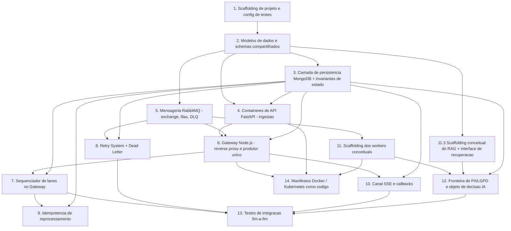

# Implementation Plan: System Design (Midea Speech-to-Text — First Slice)

*Plano de Implementação*

## Overview

*Visão Geral*

Este plano converte o design aprovado (`design.md`) e os requisitos (`requirements.md`) em tarefas de codificação incrementais e orientadas a testes para a **primeira fatia do backend**. A abordagem constrói, nesta ordem: estrutura de projeto e modelos de dados → camada de persistência (MongoDB) → contêineres de API FastAPI (ingestão) → mensageria RabbitMQ (direct-exchange + filas + DLQ) → Gateway/Orquestrador Node.js (reverse proxy, produtor único, sequenciador de lanes) → Retry System → canal SSE → scaffolding dos três workers conceituais → manifestos Docker/Kubernetes como código.

A lane de IA passa a consultar um **RAG conceitual local/offline sobre os scripts dos atendentes** (coleção `attendant_scripts`, recuperação somente leitura) para **fundamentar a validação de aderência ao roteiro**; cada `ai_decisions` registra em `scriptContextRefs` as referências de contexto de script recuperadas que embasam os veredictos de aderência.

As **10 Propriedades de Correção** do design são validadas por tarefas de **Property-Based Testing (PBT)**, posicionadas próximas da implementação que exercitam. Cada tarefa referencia os requisitos que implementa (`_Requirements: X.Y_`) e as tarefas de teste de propriedade referenciam a propriedade validada (`_Valida Property N_`).

**Stack e estrutura existente considerada:**
- Projeto Node.js na raiz (`package.json` com husky/commitlint/semantic-release) → base para o **Gateway/Orquestrador** (`App/Gateway`).
- Backend Python em `App/Backend` com `requirements.txt` (fastapi, faster-whisper, noisereduce, librosa, soundfile, pydub, pydantic) e venv → base para os **contêineres FastAPI** e **workers conceituais**.
- `App/Frontend` vazio → fora do escopo desta fatia de backend.

**Convenção de testes:**
- Python (FastAPI, workers, modelos de dados): `pytest` + `hypothesis` (PBT).
- Node.js (Gateway, roteamento, sequenciamento, retry, SSE): `vitest` + `fast-check` (PBT).

---

## Grafo de Dependência de Tarefas (ordenação entre tarefas de topo)



---

## Tasks

- [x] 1. Preparar scaffolding de projeto e frameworks de teste
  - Criar a estrutura `App/Gateway/src` (Node.js) e `App/Backend/app` (FastAPI) com módulos esqueleto e um diretório compartilhado de contratos (`App/shared` para nomes de routing keys, enums de status/lane/state e eventos SSE).
  - Configurar o framework de testes Python: adicionar `pytest`, `pytest-asyncio` e `hypothesis` ao `App/Backend/requirements.txt` e criar `App/Backend/pytest.ini` com um teste de fumaça.
  - Configurar o framework de testes Node.js: adicionar `vitest` e `fast-check` como devDependencies no `package.json` e criar `App/Gateway/vitest.config.*` com um teste de fumaça.
  - Definir, em módulo compartilhado, as constantes fechadas das routing keys `{routingKey.audio, routingKey.transcript, routingKey.AI}` e os enums `status`, `lane`, `state`, reutilizados por Gateway e workers.
  - _Requirements: 11.3, 11.4_

- [ ] 2. Implementar modelos de dados e schemas de validação
  - [ ] 2.1 Definir schemas Pydantic do payload de upload e da confirmação
    - Implementar o modelo de validação de upload (formato de áudio dentre os suportados, tamanho entre 1 byte e 500 MB, cada campo textual de metadados com no máximo 1024 caracteres) e o modelo de resposta de confirmação contendo o `call_jobs._id`.
    - Implementar o modelo de resposta de erro de validação que indica o campo/regra violada.
    - _Requirements: 1.1, 1.2, 1.5_

  - [ ] 2.2 Definir os modelos das coleções MongoDB
    - Implementar os schemas conceituais de `call_jobs` (com `status` enum `RECEIVED|NOISE|TRANSCRIPT|AI|DONE|FAILED`, `audioRef`, `_id`), `workflow_states` (`lane`, `state` enum `QUEUED|PROCESSING|SUCCESS|FAILED`, `outputRef`, `attempts`), `transcripts` (`segments[].speaker` enum `AGENT|CONSUMER`, `piiMasked`), `ai_decisions` (`decision`, `rulesEvaluated[].verdict` enum `PASS|FAIL|NOT_APPLICABLE`, `scriptContextRefs[]`, `summary`), `attendant_scripts` (coleção conceitual da base de scripts dos atendentes, com `scriptId`, `version`, `content`, `chunks[]`, `active`) e `retry_metadata` (`attempts`, `maxAttempts`, `deadLettered`).
    - Modelar `ai_decisions.scriptContextRefs` como lista de referências ao contexto de script recuperado do RAG (ex.: `scriptId`, `version`, trecho/chunk), apontando para entradas de `attendant_scripts`.
    - Incluir as regras de validação de nível de schema: `audioRef` obrigatório e não vazio; `outputRef` presente quando `state = SUCCESS`; `speaker` restrito ao enumerado; `summary` com no máximo 2000 caracteres; todo veredicto de aderência ao script em `ai_decisions.rulesEvaluated` (`PASS`/`FAIL`) deve estar associado a pelo menos uma entrada de `ai_decisions.scriptContextRefs`.
    - _Requirements: 7.5, 7.8, 1.4, 6.5, 12.3, 12.4, 13.3, 13.6, 12.6_

  - [ ]* 2.3 Escrever testes unitários dos schemas de validação de payload
    - Testar aceitação de payload válido e rejeição de formato não suportado, tamanho fora de faixa e metadados acima de 1024 caracteres, verificando a indicação do campo/regra violada.
    - _Requirements: 1.1, 1.2, 1.3_

- [ ] 3. Implementar a camada de persistência MongoDB e invariantes de estado
  - [ ] 3.1 Implementar o repositório de `call_jobs` e `workflow_states`
    - Escrever funções de criação/atualização de `call_jobs` (criação com `status = RECEIVED` e `audioRef` presente) e de transição de `call_jobs.status` para a lane ativa (`NOISE|TRANSCRIPT|AI`), `DONE` ao sucesso da lane AI e `FAILED` em falha terminal.
    - Impor unicidade por `(jobId, lane)` em `workflow_states` via índice único e tratar violação sinalizando erro à operação chamadora sem alterar o documento existente.
    - Registrar `state = SUCCESS` com `outputRef` presente e não vazio ao concluir uma lane; `state = FAILED` em falha terminal.
    - _Requirements: 7.1, 7.2, 7.3, 7.4, 7.5, 7.6, 7.7, 7.8_

  - [ ] 3.2 Implementar os repositórios de `transcripts`, `ai_decisions` e `retry_metadata`
    - Escrever persistência que impede gravar documento em `transcripts` com `piiMasked` ausente/`false` e preserva o estado da coleção.
    - Escrever persistência de `retry_metadata` que define `deadLettered = true` se e somente se `attempts >= maxAttempts`.
    - _Requirements: 6.2, 5.6, 5.4_

  - [ ]* 3.3 Escrever teste de propriedade para consistência de estado
    - **Property 7: Consistência de estado** — para qualquer sequência de operações sobre um `(jobId, lane)`, existe no máximo um documento em `workflow_states` e `call_jobs.status` reflete a lane/estado corrente.
    - _Valida Property 7_
    - _Requirements: 7.1, 7.2_

  - [ ]* 3.4 Escrever teste de propriedade para o limite de dead-letter em metadados
    - **Property 5: Limite de tentativas** — `retry_metadata.deadLettered` é `true` se e somente se `attempts >= maxAttempts`, para qualquer valor de `attempts` e `maxAttempts` em faixa válida.
    - _Valida Property 5_
    - _Requirements: 5.6_

- [ ] 4. Implementar os contêineres de API FastAPI (ingestão via API)
  - [ ] 4.1 Implementar o endpoint de upload com validação Pydantic
    - Escrever a rota de upload que valida o payload com os schemas da tarefa 2.1 antes de aceitar o Job; em payload inválido, rejeitar sem criar documento em `call_jobs`, retornar erro de validação com o campo/regra violada e preservar o estado do sistema.
    - Em upload válido, criar o documento `call_jobs` (via repositório da tarefa 3.1) com `_id` único, `status = RECEIVED` e `audioRef` presente, e retornar ao cliente a confirmação com o `call_jobs._id`.
    - Encaminhar áudio `.WAV` não comprimido ao pipeline sem recompressão/transcodificação com perdas antes da lane NOISE.
    - _Requirements: 1.1, 1.2, 1.3, 1.4, 1.5, 1.7_

  - [ ] 4.2 Implementar o endpoint de readiness/health e o emissor de eventos SSE de progresso
    - Expor endpoint de prontidão que o Gateway consulta para decidir disponibilidade.
    - Implementar a emissão de eventos SSE de progresso (`NOISE_DONE`, `TRANSCRIPT_DONE`, `AI_DONE`, `FAILED`) direcionados ao Gateway para retransmissão, e o recebimento de callbacks de mudança de estado.
    - _Requirements: 2.3, 9.3, 9.4_

  - [ ]* 4.3 Escrever testes de contrato do endpoint de upload
    - Testar que upload válido cria `call_jobs._id` e retorna confirmação; que payload inválido não cria documento; e que o contrato de resposta de erro indica o campo violado.
    - _Requirements: 1.1, 1.3, 1.4, 1.5_

- [ ] 5. Implementar a mensageria RabbitMQ (exchange, filas e DLQ)
  - [ ] 5.1 Declarar o direct-exchange, as filas e a Dead Letter Queue
    - Escrever o módulo de topologia que declara o `direct-exchange`, as filas Noise/Transcript/AI ligadas às routing keys `routingKey.audio`/`routingKey.transcript`/`routingKey.AI`, e a DLQ para mensagens esgotadas e para routing keys inválidas.
    - Garantir que uma routing key fora do conjunto válido não seja entregue às filas Noise/Transcript/AI e seja encaminhada à DLQ, preservando a mensagem sem descarte silencioso.
    - _Requirements: 3.1, 3.2, 3.3, 3.4, 3.5_

  - [ ]* 5.2 Escrever teste de propriedade para roteamento determinístico
    - **Property 2: Roteamento determinístico** — para qualquer routing key válida, a mensagem chega exclusivamente à fila correspondente e a nenhuma outra.
    - _Valida Property 2_
    - _Requirements: 3.1, 3.2, 3.3, 3.4_

- [ ] 6. Implementar o Gateway/Orquestrador Node.js (borda, proxy e produtor único)
  - [ ] 6.1 Implementar o reverse proxy / balanceador em nível de aplicação
    - Escrever o roteamento HTTP que distribui as requisições entre os contêineres FastAPI disponíveis, considerando disponível apenas o contêiner que responde à verificação de prontidão dentro de 2 segundos.
    - Rejeitar a requisição com erro de indisponibilidade de upstream quando nenhum API_Container estiver disponível, sem publicar mensagem no Exchange para essa requisição.
    - _Requirements: 2.2, 2.3, 2.4_

  - [ ] 6.2 Implementar o produtor único de mensagens para o Exchange
    - Escrever o publicador que é o único produtor para o `direct-exchange`, publicando exclusivamente com uma das routing keys válidas conforme a lane de destino.
    - _Requirements: 2.5_

  - [ ]* 6.3 Escrever testes unitários do balanceamento e do produtor
    - Testar seleção apenas de contêineres prontos, rejeição quando nenhum está disponível (sem publicação) e que o produtor só emite routing keys válidas.
    - _Requirements: 2.2, 2.3, 2.4, 2.5_

- [ ] 7. Implementar o sequenciador das lanes no Gateway
  - [ ] 7.1 Implementar a progressão NOISE → TRANSCRIPT → AI usando `workflow_states` como fonte de verdade
    - Escrever a lógica que, ao criar Job (`status = RECEIVED`), publica `routingKey.audio` e não publica `routingKey.transcript`/`routingKey.AI` antes do sucesso da lane NOISE.
    - Ao registrar `SUCCESS` em `(jobId, NOISE)`, publicar `routingKey.transcript` e atualizar `status = TRANSCRIPT`; ao registrar `SUCCESS` em `(jobId, TRANSCRIPT)`, publicar `routingKey.AI` e atualizar `status = AI`.
    - Rejeitar avanço fora de ordem consultando `workflow_states`, sem efeito colateral na lane de destino e sem alterar `call_jobs.status`.
    - _Requirements: 4.1, 4.2, 4.3, 4.4, 4.5, 4.6_

  - [ ]* 7.2 Escrever teste de propriedade para sequenciamento das lanes
    - **Property 3: Sequenciamento das lanes** — para qualquer sequência de eventos, um Job só entra em TRANSCRIPT após sucesso em NOISE e só entra em AI após sucesso em TRANSCRIPT.
    - _Valida Property 3_
    - _Requirements: 4.2, 4.3, 4.4, 4.5_

  - [ ]* 7.3 Escrever teste de propriedade para ingestão sempre via API
    - **Property 1: Ingestão sempre via API** — nenhum trabalho é roteado a um worker sem um `call_jobs._id` criado por um endpoint de upload da API; payload inválido não gera `call_jobs` nem publicação.
    - _Valida Property 1_
    - _Requirements: 1.6, 1.3_

- [ ] 8. Implementar o Retry System + Dead Letter
  - [ ] 8.1 Implementar a política de retry com backoff e re-publicação
    - Escrever o receptor da aresta `Fail` das lanes que encaminha a mensagem ao Retry System em vez de descartá-la; usar `maxAttempts` inteiro em `[1,10]` com padrão 3.
    - Quando `attempts < maxAttempts`, incrementar o contador, aplicar backoff não decrescente e estritamente maior que o anterior entre 1 e 300 segundos, e re-publicar na fila de origem via Exchange.
    - Quando `attempts >= maxAttempts`, encaminhar à DLQ, marcar o Job como `FAILED` em `call_jobs`, registrar `retry_metadata` e preservar a mensagem.
    - Garantir que toda mensagem termine em exatamente um dos dois estados terminais (sucesso/avanço ou DLQ).
    - _Requirements: 5.1, 5.2, 5.3, 5.4, 5.5_

  - [ ]* 8.2 Escrever teste de propriedade para ausência de perda de mensagem
    - **Property 4: Ausência de perda de mensagem** — para qualquer sequência de sucessos/falhas e qualquer routing key (inclusive inválida), toda mensagem termina concluída com sucesso ou registrada na DLQ, nunca descartada silenciosamente.
    - _Valida Property 4_
    - _Requirements: 5.5, 3.5_

  - [ ]* 8.3 Escrever teste de propriedade para o limite de tentativas no fluxo de retry
    - **Property 5: Limite de tentativas** — uma mensagem é enviada à DLQ se e somente se `attempts >= maxAttempts`, com backoff estritamente crescente dentro da faixa.
    - _Valida Property 5_
    - _Requirements: 5.6, 5.3_

- [ ] 9. Implementar a idempotência de reprocessamento
  - [ ] 9.1 Implementar a verificação de idempotência baseada em `workflow_states`
    - Escrever a guarda que consulta `workflow_states` como fonte de verdade antes de qualquer efeito colateral e trata a etapa como concluída quando, e somente quando, `state = SUCCESS`.
    - Ao reprocessar um `(jobId, lane)` já em `SUCCESS`, ignorar sem reexecutar efeitos colaterais, sem criar segundo resultado, preservando o `outputRef` existente e sem republicar o avanço para a próxima lane.
    - Ao reprocessar um `(jobId, lane)` ainda não em `SUCCESS`, executar normalmente e gravar no documento único existente, sem criar documento adicional.
    - _Requirements: 8.1, 8.2, 8.3, 8.4, 8.5_

  - [ ]* 9.2 Escrever teste de propriedade para idempotência de retry
    - **Property 8: Idempotência de retry** — reprocessar a mesma mensagem após falha não produz resultados duplicados para o mesmo `(jobId, lane)` nem reemite o avanço.
    - _Valida Property 8_
    - _Requirements: 8.1, 8.2_

- [ ] 10. Implementar o canal SSE e os callbacks de estado
  - [ ] 10.1 Implementar a retransmissão SSE e os callbacks do MongoDB
    - Escrever o canal SSE no Gateway que retransmite ao dashboard os eventos de progresso emitidos pelos contêineres FastAPI e os eventos de lane concluída (`NOISE_DONE`, `TRANSCRIPT_DONE`, `AI_DONE`).
    - Emitir notificação ao dashboard em até 2 segundos nas transições para `DONE` e para `FAILED`; consumir o callback do MongoDB em transições de `call_jobs.status`/`workflow_states.state`.
    - Permitir restabelecimento da conexão SSE e retomada do fluxo de eventos sem bloquear o processamento dos Jobs.
    - _Requirements: 9.1, 9.2, 9.3, 9.4, 9.5, 9.6_

  - [ ]* 10.2 Escrever teste de propriedade para notificação de estado terminal
    - **Property 9: Notificação de estado terminal** — toda transição para `DONE` ou `FAILED` resulta em uma notificação SSE ao dashboard.
    - _Valida Property 9_
    - _Requirements: 9.1, 9.2_

- [ ] 11. Scaffolding dos três workers conceituais (interfaces apenas)
  - [ ] 11.1 Criar as interfaces/esqueletos de consumo dos workers Noise, Transcript e AI
    - Escrever os consumidores esqueleto que ligam cada worker à sua fila (Noise/Transcript/AI), com a interface `processar(mensagem) -> sucesso | Fail` e o contrato de sinalização de `Fail` ao Retry System (internals de ML permanecem conceituais/stub).
    - Ao sucesso, registrar `state = SUCCESS` com `outputRef` via repositório; ao erro, sinalizar `Fail`.
    - _Requirements: 5.1, 7.5, 11.5_

  - [ ]* 11.2 Escrever testes unitários do contrato dos workers (stub)
    - Testar que um `Fail` do stub encaminha ao Retry System e que um sucesso registra `SUCCESS` com `outputRef`.
    - _Requirements: 5.1, 7.5_

  - [ ] 11.3 Criar o scaffolding conceitual do RAG (Base de Scripts dos Atendentes) e a interface de recuperação
    - Criar o módulo/stub do RAG como fonte de recuperação somente leitura, local/offline, sobre os scripts dos atendentes; os internals de embeddings/vector-store permanecem stub/conceituais (sem implementação concreta de vector-store nesta fatia).
    - Expor a interface de recuperação `recuperarContextoDeScript(contextoDaChamada) -> [scriptContextRef]`, onde cada `scriptContextRef` carrega ao menos `scriptId`, `version` e o trecho/chunk recuperado da coleção `attendant_scripts`.
    - Criar o repositório read-only da coleção `attendant_scripts`, garantindo que nenhum worker escreva nessa base e que ela não produza mensagens para o Exchange.
    - _Requirements: 13.1, 13.2, 13.5_

- [ ] 12. Implementar a fronteira de PII/LGPD e o objeto de decisão da IA
  - [ ] 12.1 Implementar a guarda de PII no Transcript Worker (stub de mascaramento)
    - Escrever a etapa que aplica o mascaramento de PII antes de persistir `transcripts` e impede persistir com `piiMasked = false`; em falha de mascaramento, encaminhar ao Retry System e impedir a persistência não mascarada.
    - Restringir `segments[].speaker` a `AGENT|CONSUMER`, rejeitando persistência fora desse conjunto.
    - _Requirements: 6.1, 6.2, 6.5, 6.6_

  - [ ] 12.2 Implementar a geração e validação do objeto `ai_decisions`
    - Escrever o AI Worker (stub) que, ANTES de gerar a decisão, consulta o RAG (tarefa 11.3) via `recuperarContextoDeScript(contextoDaChamada)` para recuperar o contexto do script de referência aplicável.
    - Derivar `ai_decisions` somente de texto com `piiMasked = true`, gerar `decision` como JSON válido conforme o schema de negócio, registrar `rulesEvaluated[]` com veredicto `PASS|FAIL|NOT_APPLICABLE` e `summary` com no máximo 2000 caracteres e sem PII.
    - Incluir em `ai_decisions.scriptContextRefs` ao menos uma referência recuperada do RAG para cada veredicto de aderência ao script (`PASS`/`FAIL`), associando cada veredicto a pelo menos uma entrada.
    - IF o RAG não retorna contexto de script aplicável, marcar os veredictos de aderência ao roteiro como `NOT_APPLICABLE`, registrar a ausência de contexto recuperado e não fabricar/criar entradas em `scriptContextRefs`.
    - Em `decision` inválido ou fora do schema, rejeitar o resultado, não persistir `ai_decisions` e encaminhar ao Retry System com indicação de falha de validação de schema.
    - _Requirements: 12.1, 12.2, 12.3, 12.4, 12.5, 6.3, 13.1, 13.3, 13.4, 12.6_

  - [ ]* 12.3 Escrever teste de propriedade para a fronteira de PII/LGPD
    - **Property 6: Invariante de PII/LGPD** — nenhum documento em `transcripts` é persistido com `piiMasked = false` e nenhum `ai_decisions` é derivado de texto não mascarado.
    - _Valida Property 6_
    - _Requirements: 6.2, 6.3_

  - [ ]* 12.4 Escrever teste de propriedade para fundamentação no script via RAG
    - **Property 10: Fundamentação no script via RAG** — todo veredicto de aderência ao script em `ai_decisions.rulesEvaluated` (PASS/FAIL) é rastreável a pelo menos um `scriptContextRef` recuperado do RAG; quando o RAG não retorna contexto, os veredictos de aderência são `NOT_APPLICABLE` e não há `scriptContextRefs` fabricados.
    - _Valida Property 10_
    - _Requirements: 13.3, 13.4, 12.6_

- [ ] 13. Checkpoint e testes de integração do fluxo de mensageria
  - [ ] 13.1 Escrever testes de integração do backbone RabbitMQ e do encadeamento das lanes
    - Validar ponta a ponta: publicação no `direct-exchange`, roteamento às filas corretas, encadeamento NOISE → TRANSCRIPT → AI via Gateway e ausência de perda de mensagem (toda mensagem conclui ou vai para a DLQ).
    - Exercitar o loop de retry/dead-letter forçando `Fail` em cada lane e verificar a marcação `FAILED` + `retry_metadata` + notificação SSE de estado terminal.
    - _Requirements: 3.1, 3.2, 3.3, 4.1, 5.1, 5.4, 5.5, 9.1, 9.2_

  - [ ] 13.2 Checkpoint
    - Garantir que todos os testes passam; perguntar ao usuário em caso de dúvidas.

- [ ] 14. Empacotamento como código: Docker e Kubernetes
  - [ ] 14.1 Escrever os Dockerfiles do Gateway e dos contêineres FastAPI
    - Criar o `Dockerfile` do Gateway Node.js e o `Dockerfile` do contêiner FastAPI (1 servidor por contêiner), além de um `docker-compose` local com RabbitMQ, Redis e MongoDB para execução offline/local.
    - _Requirements: 11.1, 11.4, 11.5_

  - [ ] 14.2 Escrever os manifestos Kubernetes do Ingress, Gateway, API e infra
    - Criar os manifestos do Ingress/Service (expõe apenas o Gateway na borda + terminação TLS, sem expor API/workers/filas/MongoDB/Redis), do Deployment do Gateway, do Deployment de API (escala por réplicas) e dos Services de RabbitMQ/Redis/MongoDB.
    - _Requirements: 2.1, 11.5_

  - [ ]* 14.3 (Opcional/stretch) Escrever manifestos de escalonamento horizontal independente dos workers
    - Criar Deployments/HPA separados por lane (Noise/Transcript/AI) permitindo escalar workers de uma lane sem reiniciar/reconfigurar as demais.
    - _Requirements: 11.5_

- [ ] 15. Checkpoint final
  - Garantir que todos os testes passam; perguntar ao usuário em caso de dúvidas.

## Notes

*Notas*

- Tarefas marcadas com `*` são opcionais (testes e manifestos de escalonamento stretch) e podem ser puladas para um MVP mais rápido; as tarefas sem `*` são obrigatórias.
- Cada tarefa referencia requisitos específicos para rastreabilidade; tarefas de PBT referenciam a Propriedade de Correção validada.
- Os internals de ML dos três workers permanecem conceituais/stub nesta fatia — apenas interfaces, contratos de `Fail`/sucesso e as guardas de estado/PII são implementados.
- O RAG é conceitual/stub nesta fatia: apenas a interface de recuperação (`recuperarContextoDeScript`) e o repositório read-only da coleção `attendant_scripts` são implementados; os internals de embeddings/vector-store ficam deferidos para fase posterior.
- Os checkpoints garantem validação incremental antes de avançar para a integração e o empacotamento.

## Task Dependency Graph

```json
{
  "waves": [
    { "id": 0, "tasks": ["1"] },
    { "id": 1, "tasks": ["2.1", "2.2"] },
    { "id": 2, "tasks": ["2.3", "3.1", "3.2", "5.1"] },
    { "id": 3, "tasks": ["3.3", "3.4", "4.1", "4.2", "5.2", "6.1", "6.2", "11.1", "11.3"] },
    { "id": 4, "tasks": ["4.3", "6.3", "7.1", "8.1", "10.1", "11.2", "12.1"] },
    { "id": 5, "tasks": ["7.2", "7.3", "8.2", "8.3", "9.1", "10.2", "12.2"] },
    { "id": 6, "tasks": ["9.2", "12.3", "12.4", "13.1", "14.1"] },
    { "id": 7, "tasks": ["14.2", "14.3"] }
  ]
}
```
