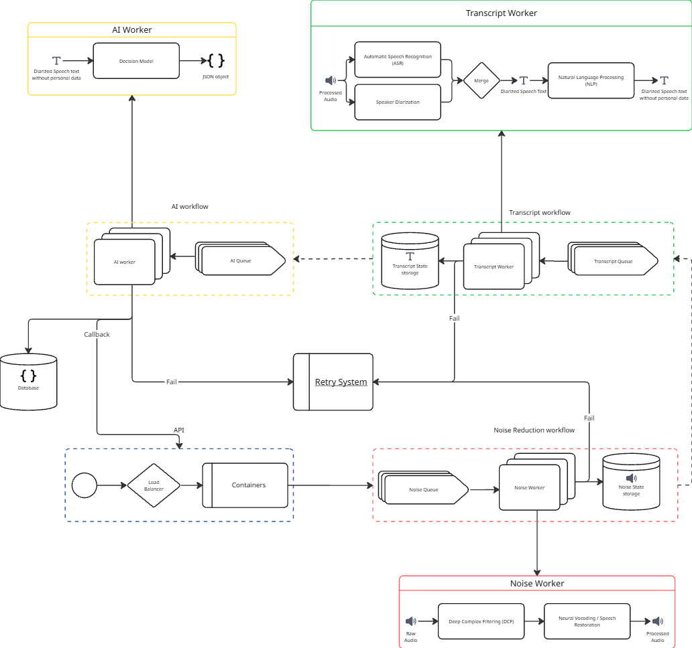

# Midea Speech-to-Text & Call Center Intelligence (PoC)

Prova de conceito desenvolvida em parceria entre a UNIFEI e a Midea (R&D) para processar gravações do call center de suporte técnico: redução de ruído, transcrição com Whisper, separação de locutores, remoção de dados pessoais (LGPD) e análise por LLM.

## Problema
O call center guarda muitas horas de gravações que hoje quase não são auditadas, porque ouvir tudo manualmente não escala. Isso causa dois problemas principais (detalhes em [Docs/Markdowns/project-brief.md](Docs/Markdowns/project-brief.md)):

- **Triagem ruim para abertura de Ordens de Serviço:** quando o atendente não coleta todas as informações, o diagnóstico por telefone sai errado e um técnico é enviado a campo sem necessidade.
- **Sem verificação sistemática do script de atendimento:** a supervisão não consegue checar se os operadores seguiram o protocolo obrigatório em todas as ligações.

## Arquitetura
Sistema assíncrono, orientado a eventos e baseado em microsserviços, pensado para rodar com ferramentas open source e localmente.



- **Gateway / Orquestrador (Node.js):** recebe o upload pela API, faz o balanceamento para os contêineres FastAPI, publica as mensagens, controla a sequência das etapas e repassa notificações ao dashboard via SSE.
- **API (Python + FastAPI):** contêineres Docker que registram os jobs. A ingestão de áudio sempre passa pela API, nunca direto pelos workers.
- **Mensageria (RabbitMQ):** direct exchange com routing keys (`routingKey.audio`, `routingKey.transcript`, `routingKey.AI`), sistema de retry e dead letter.
- **Workers, em três etapas sequenciais (NOISE, TRANSCRIPT, AI):**
  - Redução de ruído (noisereduce, librosa).
  - Transcrição com faster-whisper, diarização e mascaramento de PII.
  - Decisão por LLM local, com RAG sobre os scripts de atendimento para validar a aderência ao roteiro.
- **Persistência:** MongoDB para jobs, estados por etapa, transcrições e decisões da IA. Redis para estado efêmero.
- **Contratos compartilhados:** [App/shared/contracts.json](App/shared/contracts.json) é a fonte única de status, etapas, routing keys e eventos SSE, lida tanto pelo Node quanto pelo Python. Assim os dois lados não divergem.

## Desenvolvimento guiado por specs com Kiro
Antes de escrever código, usei o Kiro para montar e revisar a especificação do sistema em [.kiro/specs/system-design](.kiro/specs/system-design):

- `requirements.md`: requisitos com critérios de aceitação.
- `design.md`: diagramas, componentes, modelos de dados, tratamento de erros, estratégia de testes e propriedades de corretude (por exemplo, roteamento determinístico, limite de tentativas, idempotência de retry e ausência de PII na saída).
- `tasks.md`: plano de implementação em tarefas pequenas, cada uma ligada aos requisitos.

A implementação segue esse plano tarefa por tarefa.

## Estrutura
```
App/
  Backend/   API FastAPI, workers e testes (pytest, hypothesis)
  Gateway/   Gateway/Orquestrador Node.js e testes (vitest, fast-check)
  shared/    Contratos compartilhados entre Node e Python
Docs/        Product brief e diagramas de arquitetura
.kiro/       Specs do sistema (requisitos, design e tarefas)
```

## Como rodar os testes
Pré-requisitos: Python 3.12, Node.js e pnpm.

```bash
# Gateway (Node.js)
pnpm install
pnpm test:gateway

# Backend (Python)
cd App/Backend
python -m venv backend-venv
source backend-venv/bin/activate   # no Windows: backend-venv\Scripts\activate
pip install -r requirements.txt
pytest
```

Para subir a API localmente: `uvicorn app.main:app --reload` dentro de `App/Backend` (instale o `uvicorn` antes). A rota `GET /health` responde `{"status": "ok"}`.

## Qualidade e fluxo de trabalho
- Commits no padrão Conventional Commits, validados por husky e commitlint.
- Versionamento e release automáticos com semantic-release no GitHub Actions.
- Testes baseados em propriedades planejados com hypothesis (Python) e fast-check (Node).

## Status
- PoC em andamento. A Midea está testando a solução e ainda não há métricas de resultado para divulgar.
- Neste repositório, a primeira tarefa do plano (estrutura do projeto, contratos compartilhados e frameworks de teste) está concluída. Os modelos de dados, a persistência, a mensageria, o retry e os workers são as próximas tarefas do [tasks.md](.kiro/specs/system-design/tasks.md).

## Próximos passos
- Implementar o endpoint de upload com validação Pydantic e os modelos do MongoDB.
- Declarar exchange, filas e dead letter no RabbitMQ e implementar o produtor e o sequenciador no Gateway.
- Implementar o retry com backoff e a idempotência de reprocessamento.
- Medir qualidade da transcrição e tempo de processamento assim que houver dados de teste liberados.
